# Lab 1 – The OS as a Resource Manager

*Bogdan Aramă, FAF-242 · Operating Systems, UTM 2026*

## Purpose of the work

The aim of this laboratory work is to watch the operating system acting as a resource manager on a real Linux installation. Using only standard command-line tools, I looked at how the OS manages the four big resources of a computer: files, processes, memory and devices, and I wrote down what the system reported instead of only listing the commands.

## Work environment

| Item | Value |
|---|---|
| Machine | VirtualBox virtual machine, 2 vCPU, 3.3 GiB RAM, 25 GB disk |
| Operating system | Ubuntu 26.04.1 LTS (GNOME, Wayland) |
| Kernel | Linux 7.0.0-38-generic, x86_64 |
| Shell / terminal | GNU bash, Ptyxis terminal |
| Compiler | gcc 15.2.0 |

All commands were run as the ordinary user `bogdan` in a working folder `~/os-lab1`. Figure 0.1 below shows who I am for the OS, which kernel manages the machine and how long it has been running.

## Execution of the work

## Getting started

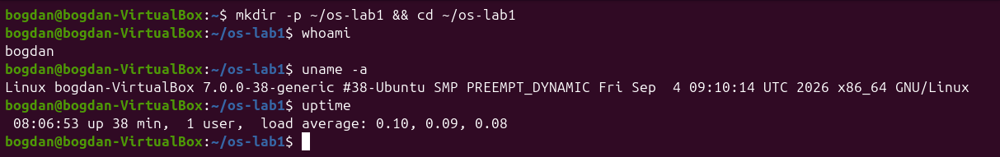
*Figure 0.1: Working folder, user, kernel and uptime*

The kernel is Linux 7.0.0-38 for x86_64 and the system had been up for 38 minutes with one user logged in.

## Part 1. Files and directories

First I looked at the top of the directory tree and at my home directory, then created, copied, renamed and removed files and changed their permissions.

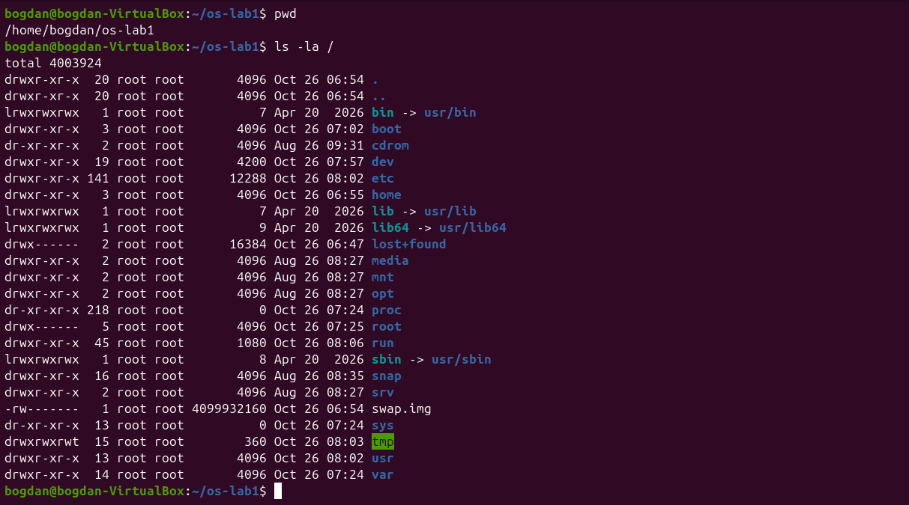
*Figure 1.1: The root of the file tree (ls -la /)*

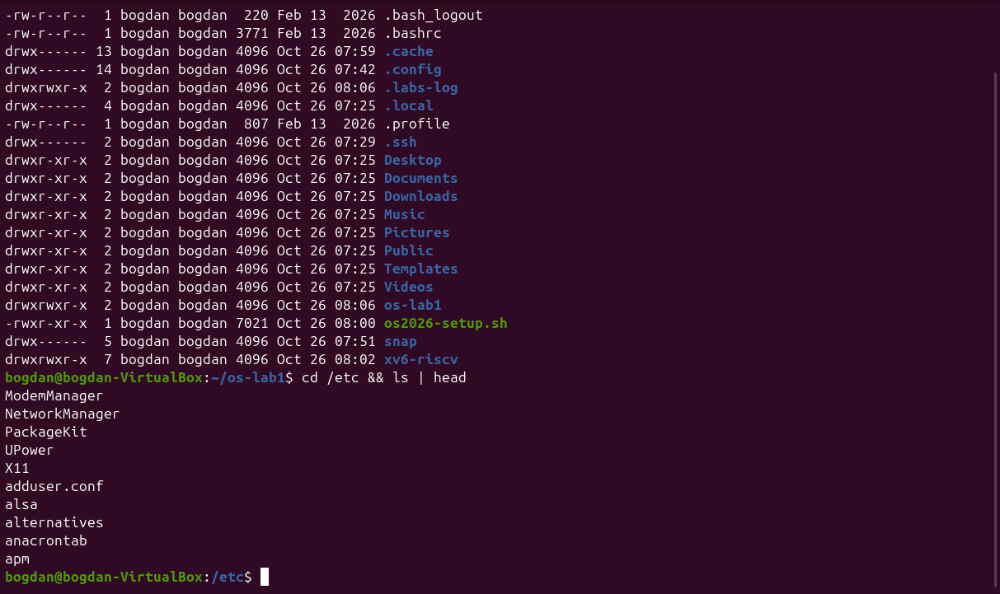
*Figure 1.2: Home directory and the first entries of /etc*

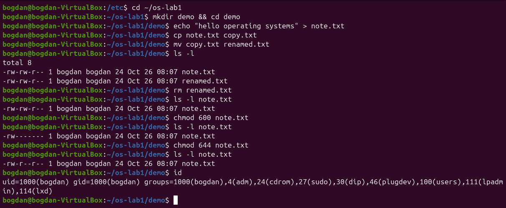
*Figure 1.3: Creating, copying, renaming, removing a file and changing its mode*

**1. Who owns the files you just created, and which group?**

Both `note.txt` and `renamed.txt` belong to user `bogdan` and group `bogdan`. On Ubuntu every user gets a private primary group with the same name (uid=1000, gid=1000 in the output of `id`), and new files are created with the owner and primary group of the process that creates them.

**2. What do the ten characters at the start of ls -l mean for note.txt after chmod 600?**

After `chmod 600` the string is `-rw-------`. The first character `-` is the file type (a regular file). The next three `rw-` are the owner's rights (read and write, no execute), and the last two groups `---` and `---` mean that the group and all other users have no rights at all. Before the change the file was `-rw-rw-r--`, the default produced by my umask 0002.

**3. Name two directories directly under / and say what they hold.**

`/etc` holds the system-wide configuration files (for example `passwd`, `fstab` and the NetworkManager settings), and `/home` holds the personal directories of the users (here only `/home/bogdan`). It is also interesting that `/bin`, `/sbin` and `/lib` are only symbolic links into `/usr`, and that `/proc` and `/sys` have size 0 because they are generated by the kernel.

## Part 2. Processes

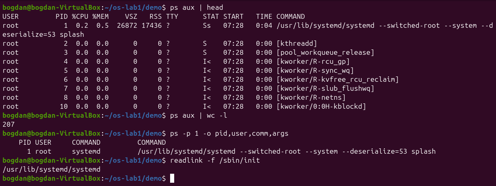
*Figure 2.1: The first processes, their number and process 1*

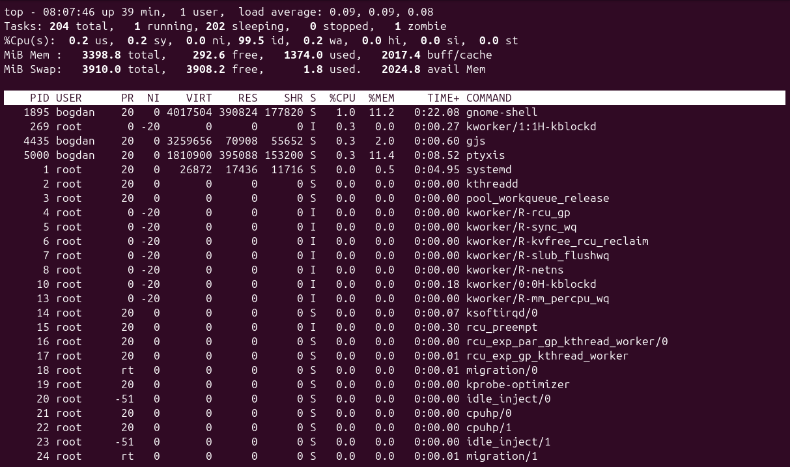
*Figure 2.2: Live view of the process table with top*

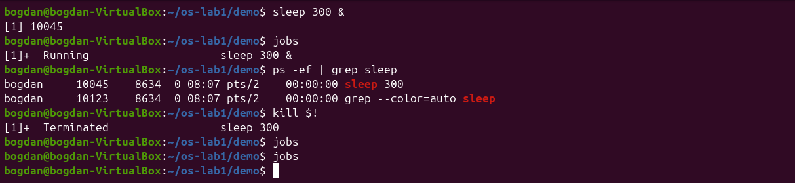
*Figure 2.3: Starting a background sleep, finding it and terminating it*

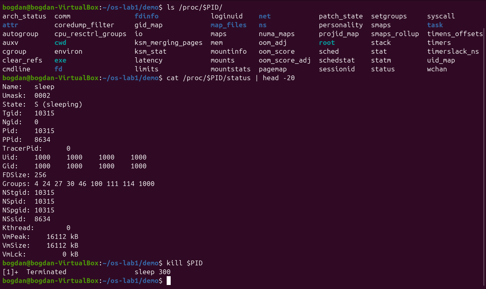
*Figure 2.4: What /proc shows about a running sleep process*

**1. What is the PID of process number 1, and what is it?**

Process 1 is `systemd` (`/usr/lib/systemd/systemd`, the target of the `/sbin/init` link), owned by root. It is the first user-space program started by the kernel at boot. It starts and supervises all the other services and it adopts orphaned processes.

**2. Roughly how many processes were running on your idle VM?**

`ps aux | wc -l` printed 207. One of those lines is the header, so there were about 206 processes, and `top` reported 204 tasks a few seconds later. Most of them are kernel threads (names in square brackets, such as `[kworker/...]`) and the services of the GNOME desktop. `top` also showed one zombie process.

**3. From /proc/<pid>/status, what does the State: line say for your sleeping process?**

It says `State: S (sleeping)`. The process is not using the CPU: it is blocked in the kernel until its timer expires. The same file also shows its PID, its parent (`PPid: 8634`, my shell) and its memory counters.

## Part 3. Memory

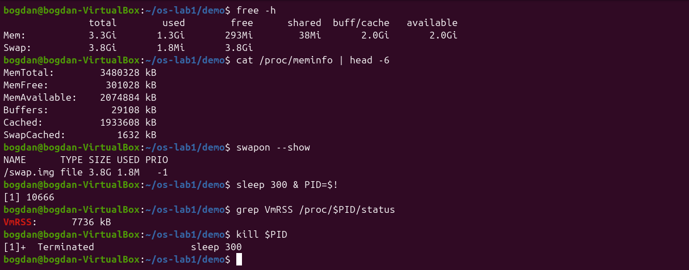
*Figure 3.1: RAM, swap and the resident memory of a sleep process*

**1. How much total RAM does the VM have, and how much is free?**

The VM has 3.3 GiB of RAM (`MemTotal: 3480328 kB`). Only 293 MiB is reported as completely free, but 2.0 GiB is available, because Linux uses otherwise idle RAM as a page cache (2.0 GiB of buff/cache) and gives it back when programs need it.

**2. What is swap, and how much is configured?**

Swap is disk space the kernel can use to hold memory pages that do not fit in RAM. Rarely used pages are moved out so that RAM is free for active ones. On this VM swap is the 3.8 GiB file `/swap.img`, and only 1.8 MiB of it is in use.

**3. How much resident memory (VmRSS) does a bare sleep process use, and does that surprise you?**

`VmRSS` was 7736 kB, about 7.5 MB, which is surprisingly large for a program that does nothing. The reason is that RSS also counts the shared libraries and the program code mapped into the process. On Ubuntu 26.04 `sleep` is part of the Rust `coreutils` multi-call binary, a single big executable for all the commands, so more code is mapped. Most of these pages are shared with other processes, so the real cost is much smaller.

## Part 4. Devices and storage

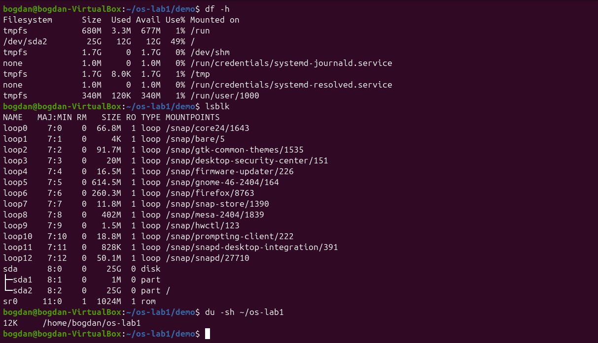
*Figure 4.1: Mounted file systems, block devices and the size of my folder*

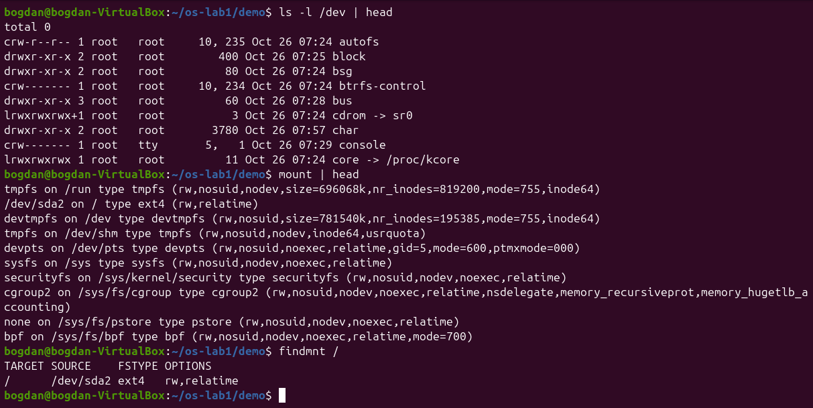
*Figure 4.2: Device files in /dev and the mount table*

**1. Which device is your root filesystem "/" mounted on?**

`/` is on `/dev/sda2`, the second partition of the virtual disk `sda`. It is formatted as ext4 (`findmnt /` shows `ext4 rw,relatime`), has 25 GB and is 49% used. `sda1` is a 1 MB partition used by the boot loader, and the many `loop` devices are snap packages mounted read-only.

**2. Give one entry from /dev and say what real thing it stands for.**

`/dev/sda` is a block device (major 8, minor 0) that stands for the whole virtual hard disk. Another example is `/dev/cdrom`, a link to `sr0`, the virtual optical drive of the VM. The character device `console` is the system console.

**3. In one sentence: what does "everything is a file" mean, based on what you saw?**

Disks, terminals, the CD drive and even kernel information (`/proc`, `/sys`) appear as names in the same tree and are used with the same open/read/write operations as ordinary files, so the same tools (`ls`, `cat`, redirection) work on all of them.

## Extra: system calls of ls

`htop` is not installed on this image, so I only did the second optional task: `strace -c ls` counts the system calls a simple `ls` makes.

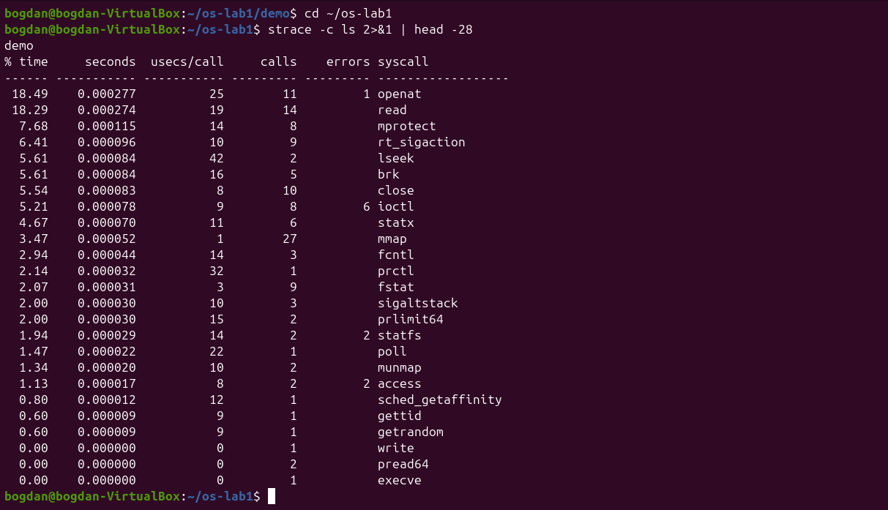
*Figure 5.1: System calls made by ls (strace -c)*

Even listing a directory with a single entry needs dozens of requests to the kernel: one `execve`, 27 `mmap` (loading the program and libraries into memory), 11 `openat`, 14 `read`, `statx` and `ioctl` (to find out whether the output is a terminal) and only one `write` for the actual output.

## Conclusions

The lab showed that the operating system sits between every program and the hardware and manages four kinds of resources. **Files**: the OS turns the disk into one tree with owners and permissions, which I saw with `ls -l` and changed with `chmod`. **Processes**: every running program is a process with a PID, a parent and a state, visible with `ps aux`, `top` and `/proc/<pid>/status`. **Memory**: the OS shares the RAM, uses free memory as cache and has swap as a backup, as shown by `free -h` and `VmRSS`. **Devices**: disks and terminals appear as files in `/dev`, and `df -h`, `lsblk` and `mount` show how they are attached to the tree.

The most useful idea for me was `/proc`: the kernel exposes its internal tables as ordinary-looking files, so the same small tools are enough to inspect almost everything the OS does.
