# Lab 2 – Meet the OS You Will Build (xv6)

*Bogdan Aramă, FAF-242 · Operating Systems, UTM 2026*

## Purpose of the work

The goal of this laboratory work is to build the teaching operating system xv6 from source, boot it in the QEMU emulator, use it as a small Unix, read its source code to see the boundary between user programs and the kernel, and add a first user program (`sleep`) that makes a real system call.

## Work environment

| Item | Value |
|---|---|
| Host system | Ubuntu 26.04.1 LTS in VirtualBox (2 vCPU, 3.3 GiB RAM) |
| Cross compiler | riscv64-linux-gnu-gcc 15.2 |
| Emulator | QEMU 10.2 (qemu-system-riscv64, machine virt, 3 harts) |
| xv6 source | mit-pdos/xv6-riscv, revision 06aad25, branch lab, in ~/xv6-riscv |
| Prepared with | os2026-setup.sh (check mode reports "All set") |

## Execution of the work

## Part 1. Building and booting xv6

The source tree contains the kernel (`kernel/`), the user programs (`user/`), the tool that creates the disk image (`mkfs/`) and the Makefile. After `make clean`, `make qemu` compiles every kernel and user file with the RISC-V cross compiler, builds `fs.img` and starts QEMU.

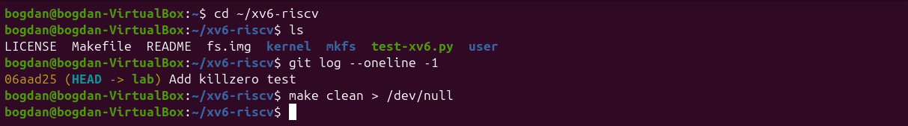
*Figure 1.1: The xv6 source tree and the revision used*

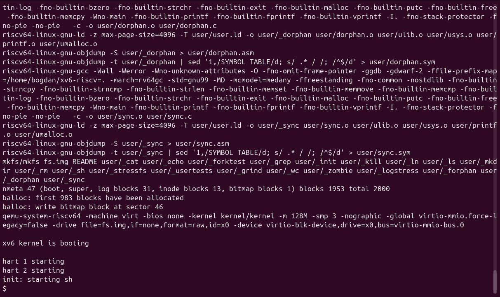
*Figure 1.2: End of the build and the boot of xv6 in QEMU*

The build ends with `mkfs` writing the file system image (2000 blocks, 47 of them metadata). Then the kernel prints `xv6 kernel is booting`, starts the other two harts (CPU cores) and `init` starts the shell, which shows the `$` prompt. QEMU is left with Ctrl-A followed by X.

## Part 2. Using xv6

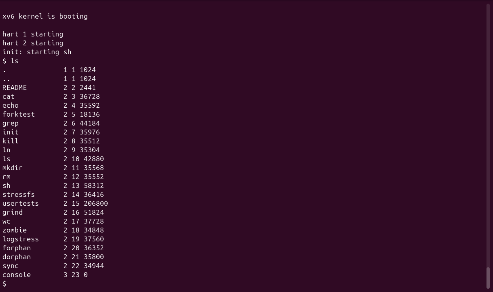
*Figure 2.1: Files of the xv6 root directory*

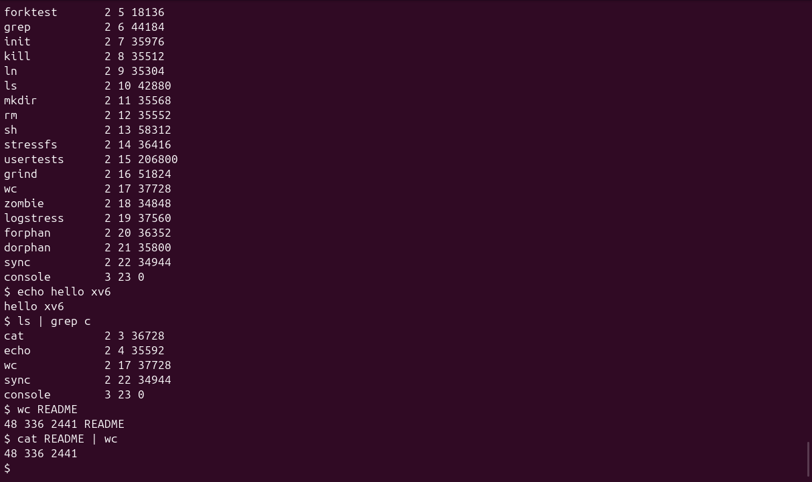
*Figure 2.2: echo, a pipe into grep, and wc inside xv6*

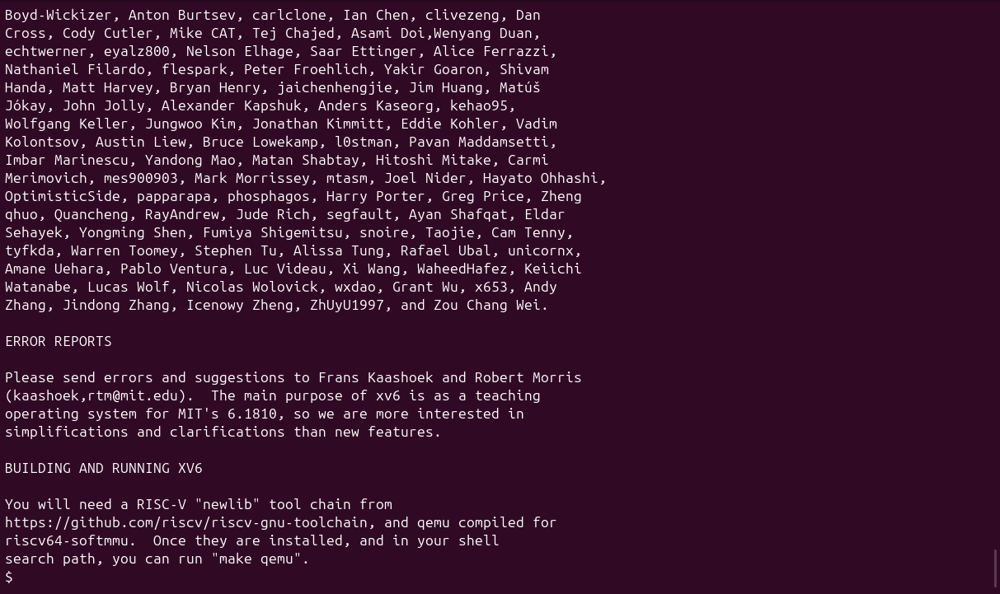
*Figure 2.3: Reading the README file with cat*

**1. List three programs xv6 ships with.**

`ls`, `cat`, `grep`, `wc`, `echo`, `mkdir`, `rm`, `ln`, `kill` and the shell `sh`, plus test programs such as `usertests`, `forktest` and `stressfs`. In `ls`, each line shows the name, the type (1 directory, 2 file, 3 device), the inode number and the size.

**2. Which two OS features must exist for a pipe to work?**

First, **process creation**: the shell must `fork` two processes (`ls` and `grep`) that run at the same time. Second, **inter-process communication with file descriptors**: the kernel must provide the `pipe` object, a buffer with a write end and a read end. The shell connects the write end to the standard output of `ls` and the read end to the standard input of `grep` (using `close` and `dup`).

**3. How does the xv6 shell compare to the Linux shell from Lab 1?**

It looks and feels the same for simple commands (pipes, `;`, redirection and `&` all work), but it is much more limited: there is no history, no Tab completion, no variables and no wildcards, and `ls` prints raw inode information instead of colours and permissions.

## Part 3. Reading the source

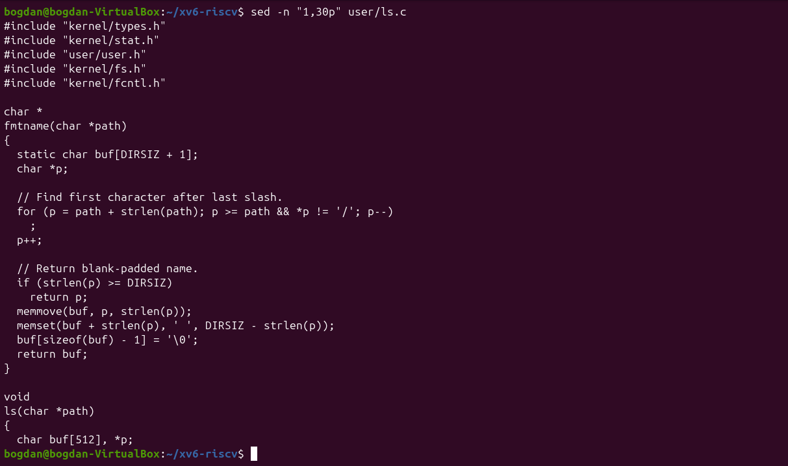
*Figure 3.1: The beginning of user/ls.c*

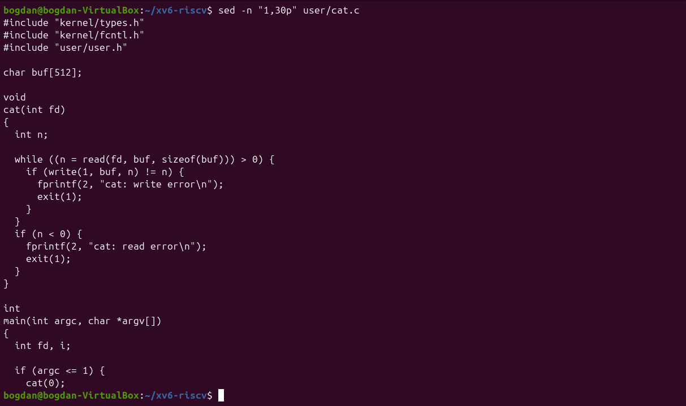
*Figure 3.2: The beginning of user/cat.c*

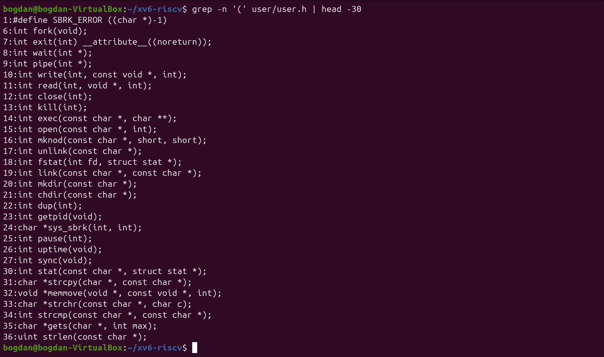
*Figure 3.3: The system calls declared in user/user.h*

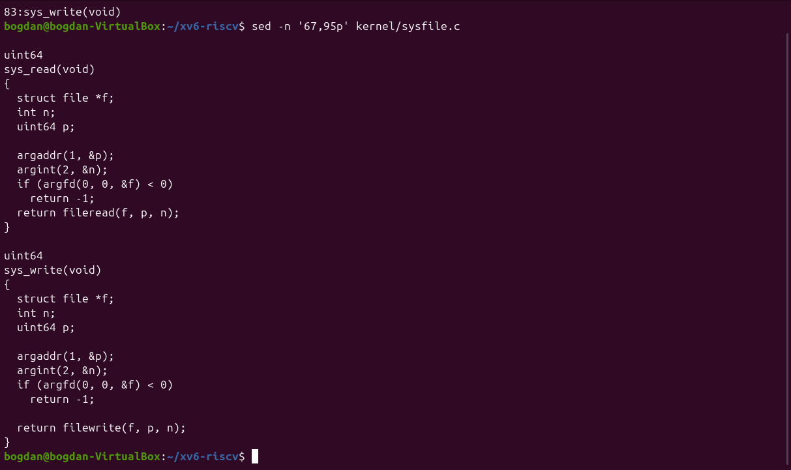
*Figure 3.4: sys_read and sys_write in kernel/sysfile.c*

**1. Which system calls does user/cat.c use, and what does each one ask the kernel to do?**

`read(fd, buf, n)` asks the kernel to copy up to n bytes from an open file into the buffer. `write(1, buf, n)` asks it to send bytes to the standard output (and `fprintf(2, ...)` ends in `write` on descriptor 2). `open(path, O_RDONLY)` asks it to find a file by name and return a new file descriptor. `close(fd)` releases that descriptor, and `exit(status)` ends the process. When there is no argument, `cat` reads descriptor 0.

**2. In which kernel file, and on which line, is sys_read implemented?**

In `kernel/sysfile.c`: the function name `sys_read(void)` is on line 69, with its return type `uint64` on line 68, and `sys_write` follows on line 83. `sys_read` fetches its three arguments from the user registers (`argaddr`, `argint`, `argfd`) and calls `fileread`.

**3. What is the difference between the code in kernel/ and the code in user/?**

The code in `kernel/` runs in supervisor mode, with access to all memory and to the hardware, and implements the services. The code in `user/` runs in user mode, isolated in its own address space, and can only ask for those services through the system calls listed in `user/user.h`.

## Part 4. My first xv6 program: sleep

I created `user/sleep.c` exactly as given in the assignment and added `$U/_sleep\` to the UPROGS list of the Makefile, right after `_echo` (TAB at the start, backslash at the end).

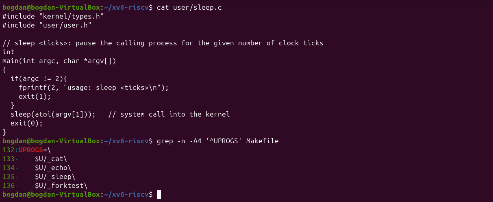
*Figure 4.1: The first version of user/sleep.c and the UPROGS line*

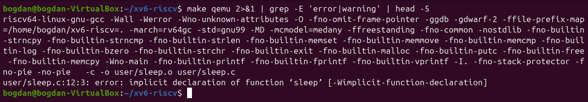
*Figure 4.2: The build fails: sleep() is not declared*

The build failed with `implicit declaration of function 'sleep'`. The reason is that the current xv6 (revision 06aad25) renamed the system call: `user/user.h` declares `int pause(int);` and no longer has `sleep`, and xv6 compiles with `-Werror`. I changed the call to `pause(atoi(argv[1]))`, which takes the same argument (a number of clock ticks).

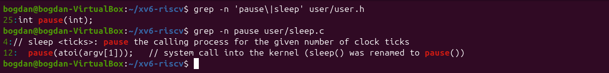
*Figure 4.3: user.h declares pause(); the corrected call in sleep.c*

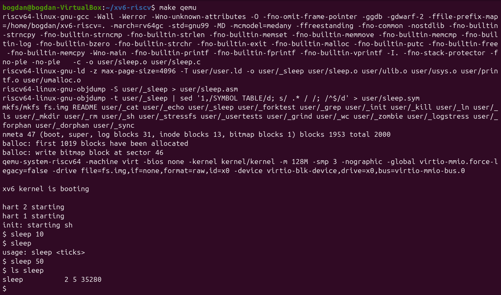
*Figure 4.4: sleep running inside xv6, with and without an argument*

After the rebuild, `sleep 10` pauses for a moment and returns to the prompt, `sleep` without an argument prints `usage: sleep <ticks>`, and `ls sleep` shows the new program on the xv6 disk (inode 5).

```text
#include "kernel/types.h"
#include "user/user.h"

// sleep <ticks>: pause the calling process for the given number of clock ticks
int
main(int argc, char *argv[])
{
  if(argc != 2){
    fprintf(2, "usage: sleep <ticks>\n");
    exit(1);
  }
  pause(atoi(argv[1]));   // system call into the kernel (sleep() was renamed to pause())
  exit(0);
}
```

## Conclusions

In this lab I compiled a whole operating system with a cross compiler, booted it on an emulated RISC-V machine and used it like a small Unix. Reading `user/cat.c` next to `kernel/sysfile.c` made the user/kernel split concrete: a call such as `read()` in a user program ends up in `sys_read` in the kernel.

Writing `sleep` also showed that system call interfaces change: the program from the assignment no longer compiled because `sleep` had become `pause`, and the fix was to read `user/user.h`, which is the real contract between user programs and the kernel.
