# Lab 5 – The File System with Your Own Hands

*Bogdan Aramă, FAF-242 · Operating Systems, UTM 2026*

## Purpose

The purpose of Lab 5 is to check the ideas of the file system lecture on a real Linux system: the directory tree and the file types, inodes as the objects behind file names, hard and symbolic links, permissions and special bits, and the disks and kernel information exposed as files. No programming is involved, only careful observation of what the commands report.

## Environment

| Item | Value |
|---|---|
| Machine | VirtualBox virtual machine, 2 vCPU, 3.3 GiB RAM, 25 GB disk |
| Operating system | Ubuntu 26.04.1 LTS (GNOME, Wayland) |
| Kernel | Linux 7.0.0-38-generic, x86_64 |
| Shell / terminal | GNU bash, Ptyxis terminal |
| Compiler | gcc 15.2.0 |

All experiments were run as the normal user `bogdan` (not root, because root ignores most permission checks) in the folder `~/os-lab5`.

## Getting started

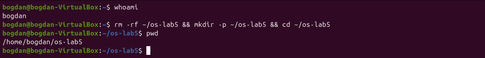
*Figure 5.0.1: Normal user and the working folder*

## Part 1. The tree and the file types

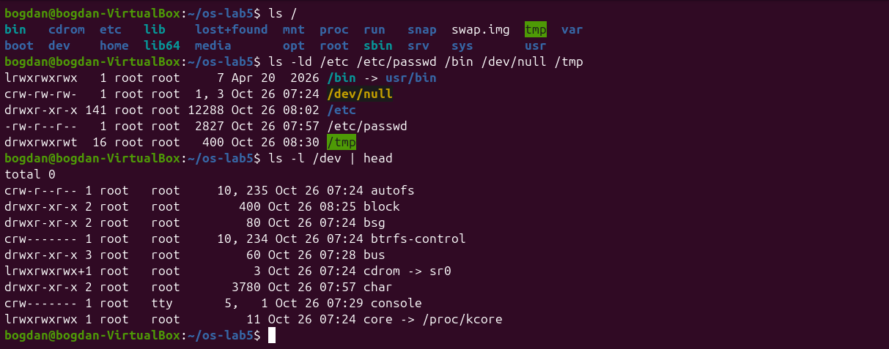
*Figure 5.1.1: The root directory and the file type letters*

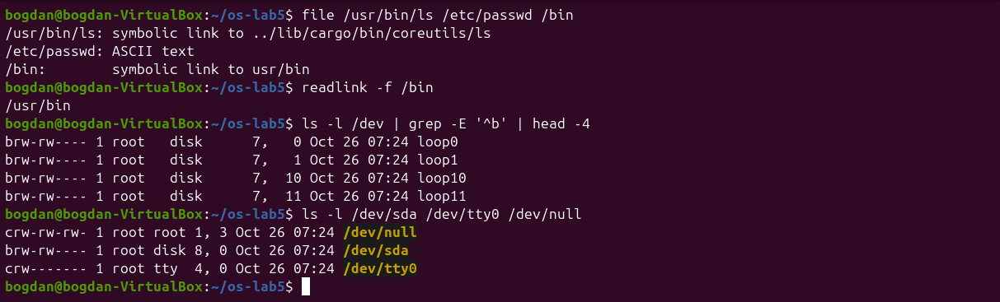
*Figure 5.1.2: file, the /bin link, block and character devices*

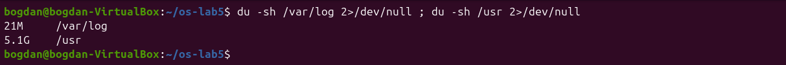
*Figure 5.1.3: Disk usage of /var/log and /usr*

**1. For each path in the second line, write its type from the first letter of ls -l.**

`/etc` is `d`, a directory. `/etc/passwd` is `-`, a regular file. `/bin` is `l`, a symbolic link. `/dev/null` is `c`, a character device (major 1, minor 3). `/tmp` is `d`, a directory, with the extra `t` bit (`drwxrwxrwt`).

**2. What is /bin on your system: a directory or a link, and to where?**

A symbolic link: `/bin -> usr/bin` (`file` says `symbolic link to usr/bin` and `readlink -f /bin` gives `/usr/bin`). Modern Ubuntu keeps all programs in `/usr` (the "merged /usr" layout). On this release `/usr/bin/ls` is itself a link to the Rust coreutils binary `../lib/cargo/bin/coreutils/ls`.

**3. Find one character device and one block device in /dev.**

Character devices: `/dev/null` (1,3), `/dev/tty0` (4,0) and `/dev/console`. Block devices: `/dev/sda` (8,0), the whole virtual disk, and `/dev/loop0` (7,0), the loop device behind a snap package. Character devices are read as a stream of bytes, while block devices are read in blocks at any position.

**4. Which is bigger on your laptop, /var/log or /usr, and by roughly how much?**

`/usr` is much bigger: 5.1 GB against 21 MB for `/var/log`, about 250 times more. `/usr` holds all installed programs and libraries, while `/var/log` holds only the logs of a VM installed today.

## Part 2. Inodes and links

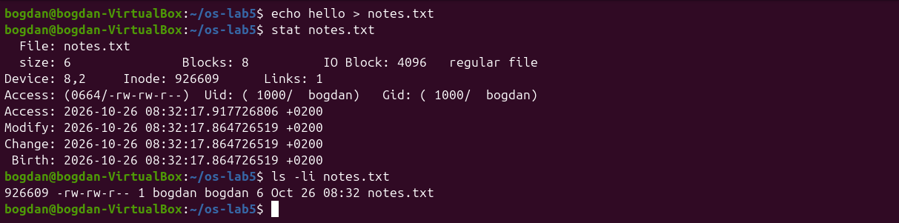
*Figure 5.2.1: stat shows the inode behind notes.txt*

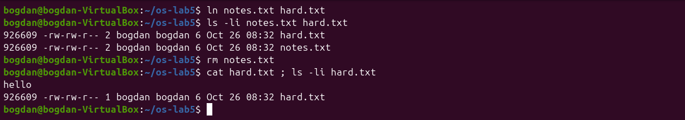
*Figure 5.2.2: A hard link survives the removal of the original name*

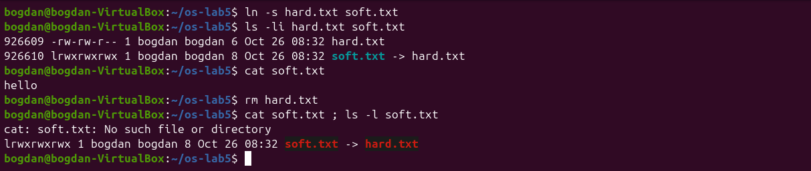
*Figure 5.2.3: A symbolic link breaks when its target is removed*

Prediction for the directory: I expected 2 links for a new directory (its name and `.`), and 4 after creating two subdirectories, because each subdirectory's `..` points back to it. Both predictions were correct.

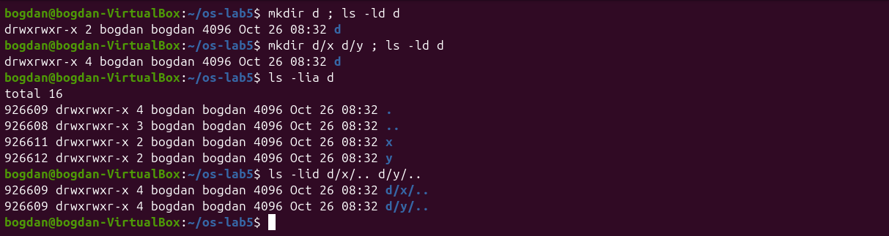
*Figure 5.2.4: Link count of a directory before and after creating subdirectories*

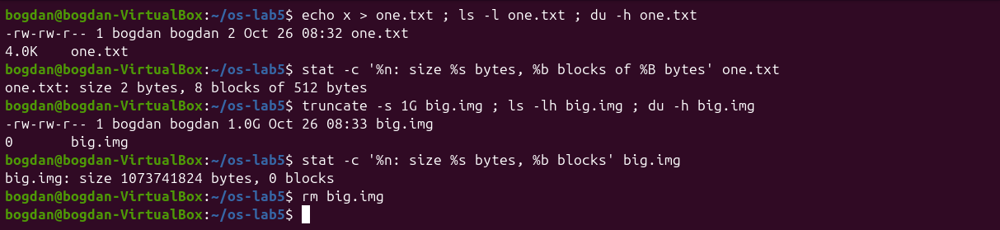
*Figure 5.2.5: Size is not space: a 2-byte file and a 1 GB sparse file*

**1. Which number in stat is the inode, and which tells how many names the file has?**

`Inode: 926609` is the inode number (the same number `ls -li` prints in the first column), and `Links: 1` is the link count, the number of directory entries (names) that point to that inode.

**2. After rm notes.txt, why could you still read hard.txt? What does rm really remove?**

`ln` created a second name for the same inode 926609, so the link count became 2. `rm` (the `unlink` system call) removes only one directory entry and decrements the count to 1. The inode and its data blocks are freed only when the link count reaches 0 and no process has the file open. The content `hello` was still reachable through the other name.

**3. Why did cat soft.txt fail at the end, although soft.txt still exists? How big is soft.txt and why exactly that size?**

A symbolic link is a separate small file (its own inode 926610, type `l`) whose content is just the path `hard.txt`. After `rm hard.txt` that path leads nowhere, so opening `soft.txt` fails with "No such file or directory": the link is dangling. Its size is 8 bytes, exactly the length of the string `hard.txt`.

**4. A new directory has 2 links, and 4 after you create two subdirectories. Explain where each link comes from.**

The 2 initial links are the entry `d` in the parent directory and the entry `.` inside `d` itself. Each subdirectory has an entry `..` that points back to `d`, which adds one link per subdirectory: 2 + 2 = 4. `ls -lid d/x/.. d/y/..` shows the same inode as `d`. Here the new directory happened to reuse inode 926609, which had been freed when `hard.txt` was removed.

**5. Why does a 2-byte file use 4.0K, and a 1 GB file use 0?**

Disk space is allocated in whole blocks, and ext4 uses 4 KiB blocks, so even 2 bytes take one block (`stat` shows 8 sectors of 512 bytes). `truncate -s 1G` only sets the size in the inode without writing any data. Such a sparse file has no allocated blocks (0 blocks in `stat`), and reading it returns zeros. `ls -l` shows the size, while `du` shows the space actually used.

## Part 3. Permissions

Prediction for the box experiment: with only `r` I expected `ls` to work and `cat box/f` to fail, and with only `x` the opposite. That is what happened.

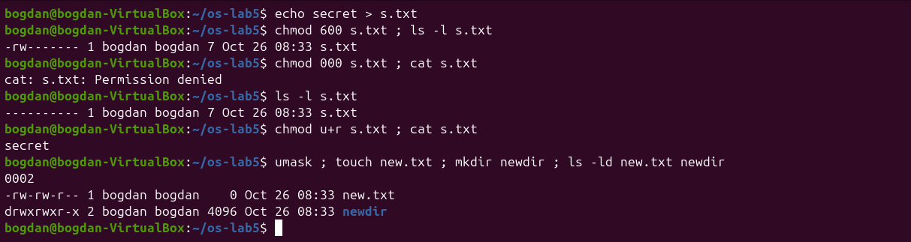
*Figure 5.3.1: Permissions of a file, chmod 000, and the umask*

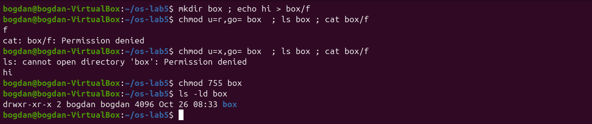
*Figure 5.3.2: The box experiment: r and x on a directory*

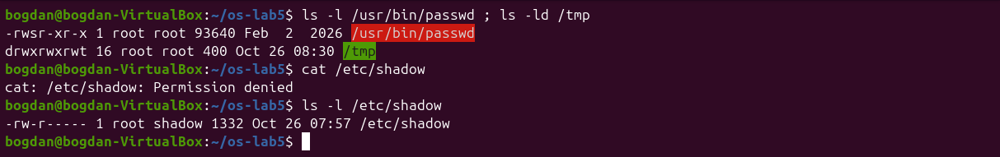
*Figure 5.3.3: The setuid bit of passwd, the sticky bit of /tmp, /etc/shadow*

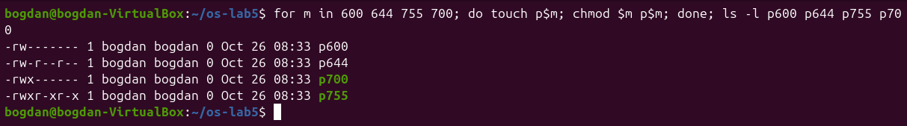
*Figure 5.3.4: The modes 600, 644, 755 and 700 as rwx strings*

**1. Write 600, 644, 755 and 700 as rwx strings, and give one real use for each.**

600 = `rw-------`, for private files such as an SSH private key (`~/.ssh/id_ed25519`). 644 = `rw-r--r--`, for normal documents and configuration files that everybody may read, such as `/etc/passwd`. 755 = `rwxr-xr-x`, for programs and public directories (`/usr/bin/*`, the `box` directory at the end). 700 = `rwx------`, for private directories and personal scripts, for example `~/.ssh`.

**2. With chmod 000 you own the file but cannot read it. Why does ownership not help?**

The kernel picks one class of permission bits: the owner bits if I am the owner, otherwise the group bits, otherwise the other bits. As the owner I get only the owner bits, which are `---`. Ownership only gives me the right to change the mode with `chmod`, which is how `chmod u+r` made the file readable again.

**3. What is your umask, and how does it explain the permissions of new.txt and newdir?**

The umask is `0002`: it removes the write bit for "others". Programs create files with mode 666 and directories with 777, minus the umask: 666 − 002 = 664 = `rw-rw-r--` for `new.txt`, and 777 − 002 = 775 = `rwxrwxr-x` for `newdir`.

**4. Explain the box experiment: what does r allow on a directory, and what does x allow?**

A directory is a table of names. `r` allows reading that table, so `ls box` printed `f`, but without `x` the names cannot be used to reach the files and `cat box/f` was denied. `x` allows passing through the directory to a name you already know, so `cat box/f` printed `hi`, but without `r` the table cannot be listed: `ls` failed with "Permission denied".

**5. What do the s in /usr/bin/passwd and the t in /tmp mean, and why does passwd need the s?**

`s` in the owner execute position (`-rwsr-xr-x`, owner root) is the setuid bit: the program runs with the rights of its owner, root, not of the user who started it. `passwd` needs it because it must write the new password hash into `/etc/shadow`, which belongs to root and is readable only by root and the group `shadow` (`-rw-r-----`). My own `cat /etc/shadow` was denied. `t` on `/tmp` (`drwxrwxrwt`) is the sticky bit: everybody may create files there, but only the owner of a file (or root) may delete or rename it.

## Part 4. Disks and the kernel as files

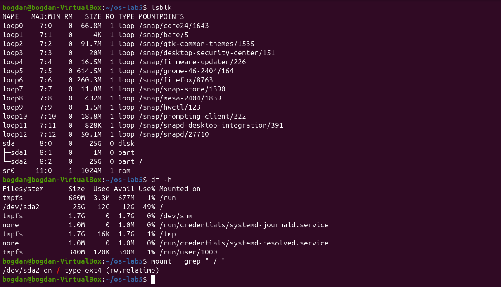
*Figure 5.4.1: Block devices, file systems and the root mount*

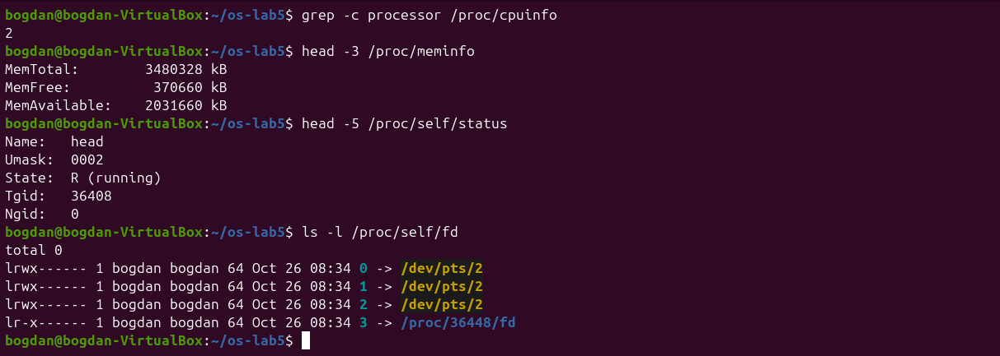
*Figure 5.4.2: CPU, memory and the current process seen through /proc*

**1. Draw your disk: disk name, partitions, which one is mounted at / and with what file system type.**

The structure is shown below. The `loop0`–`loop12` devices are read-only snap images and `sr0` is the empty virtual CD drive.

```text
sda  (25 GB virtual disk, /dev/sda, 8:0)
├── sda1     1 MB   BIOS boot partition (GRUB core), not mounted
└── sda2    25 GB   ext4, mounted at /   (rw,relatime)
```

**2. How full is your root file system?**

`df -h` shows `/dev/sda2 25G 12G 12G 49% /`: about half of the disk is used.

**3. How many CPU cores and how much RAM does your laptop have, according to /proc?**

`grep -c processor /proc/cpuinfo` gives 2 cores (the 2 vCPUs given to the VM), and `MemTotal: 3480328 kB` is about 3.3 GiB of RAM.

**4. /proc/self/status showed the name of a program. Which one, and why that one?**

It showed `Name: head`. `/proc/self` is a link that always points to the directory of the process that opens it, and the process reading the file was `head` itself, not the shell. In the same way `ls -l /proc/self/fd` showed the descriptors of `ls`: 0, 1 and 2 on the terminal and 3 on the directory it was reading.

## Stretch tasks

I did three of the optional tasks (a, b and c). Task d needs sudo, so I skipped it.

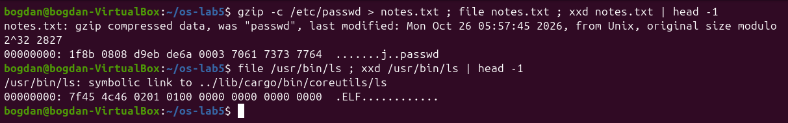
*Figure 5.5.1: (a) Magic numbers of a gzip file and of an ELF program*

**(a)** After `gzip -c /etc/passwd > notes.txt`, `file` still recognises the data as `gzip compressed data, was "passwd"`, because it ignores the extension and reads the first bytes. The magic number is `1f 8b`, which starts every gzip stream. For comparison, the real `ls` binary starts with `7f 45 4c 46`, that is `\x7fELF`.

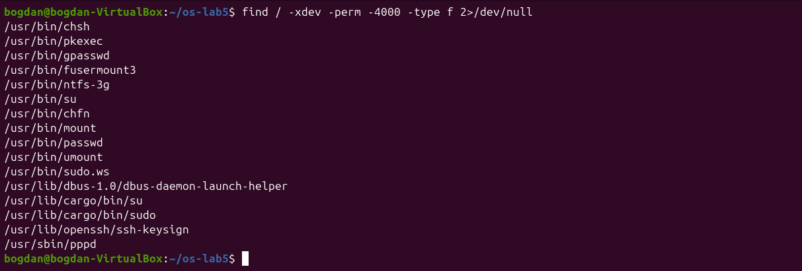
*Figure 5.5.2: (b) setuid programs on the root file system*

**(b)** `find / -xdev -perm -4000 -type f` lists 16 setuid programs: the classic ones (`passwd`, `su`, `mount`, `umount`, `chsh`, `chfn`, `gpasswd`, `pkexec`) and also some less expected ones: `/usr/bin/sudo.ws`, `/usr/lib/cargo/bin/sudo` and `/usr/lib/cargo/bin/su` (Ubuntu 26.04 ships the Rust rewrites sudo-rs and su), `ntfs-3g`, `fusermount3`, `pppd`, `ssh-keysign` and the D-Bus launch helper.

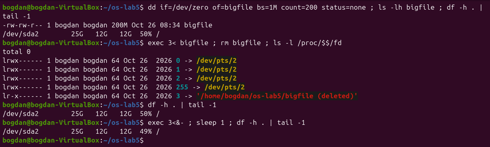
*Figure 5.5.3: (c) Deleting a file that is still open*

**(c)** After opening a 200 MB file on descriptor 3 and deleting it, `/proc/$$/fd/3` points to `'/home/bogdan/os-lab5/bigfile (deleted)'`, and `df` still shows the space as used (50%). Only after `exec 3<&-` closed the last descriptor did usage drop back to 49%. The kernel frees an inode when both its link count and its open count are zero.

## Conclusion

Lab 5 showed that a file name is only an entry in a directory that points to an inode. The inode holds the type, permissions, link count and block list. Hard links are just more names for the same inode, `rm` removes a name and not the data, and a symbolic link is a tiny file that stores a path. Permissions are checked by class (owner, group, others) and mean different things on files and directories. The special bits (setuid, sticky) solve real problems such as changing a password. Size and disk usage are different things, as the sparse file showed, and through `/proc` the kernel itself appears as files.
