# Lab 6 – Inside the xv6 File System

*Bogdan Aramă, FAF-242 · Operating Systems, UTM 2026*

## Purpose

The purpose of Lab 6 is to see the same ideas inside the xv6 file system, which implements inodes, directories as tables of entries, hard links and a log in a few hundred lines. I read what xv6 shows, wrote my own `mystat` program, measured the limits written in `kernel/fs.h`, and wrote a recursive `find`.

## Environment

| Item | Value |
|---|---|
| Host system | Ubuntu 26.04.1 LTS in VirtualBox (2 vCPU, 3.3 GiB RAM) |
| Cross compiler | riscv64-linux-gnu-gcc 15.2 |
| Emulator | QEMU 10.2 (qemu-system-riscv64, machine virt, 3 harts) |
| xv6 source | mit-pdos/xv6-riscv, revision 06aad25, branch lab, in ~/xv6-riscv |
| Prepared with | os2026-setup.sh (check mode reports "All set") |

All programs were added to `~/xv6-riscv` as `user/NAME.c` with a line `$U/_NAME\` in UPROGS. Before Part 1 and Part 4 the tree was cleaned with `make clean`, so that xv6 started from a fresh disk image.

## Part 1. Reading what xv6 shows

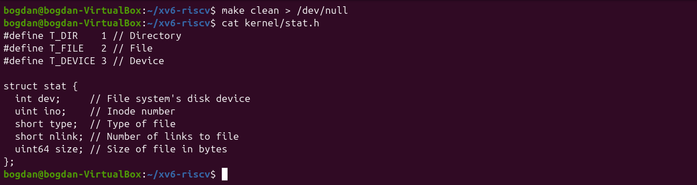
*Figure 6.1.1: kernel/stat.h: the file types and struct stat*

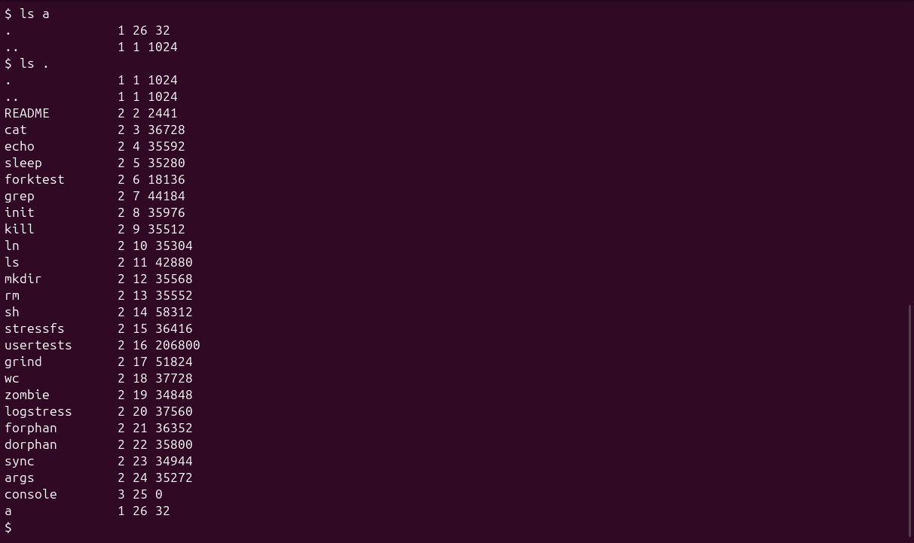
*Figure 6.1.2: ls in xv6, a new directory a and its contents*

**1. What do types 1, 2 and 3 mean (kernel/stat.h)?**

1 is `T_DIR` (a directory), 2 is `T_FILE` (a regular file) and 3 is `T_DEVICE` (a device: the only one is `console`, which is why its size is 0).

**2. Which inode number does the root directory have, and why are . and .. the same there?**

The root directory is inode 1 (`ROOTINO`). Both `.` and `..` in it point to inode 1, because the root has no parent: `mkfs` creates `..` of the root as a link to the root itself, so `cd ..` from `/` stays in `/`.

**3. An empty directory a has size 32. How big is one entry, and which two entries does a contain?**

A directory entry (`struct dirent`) is 16 bytes: a 2-byte inode number (`ushort inum`) and a 14-byte name (`DIRSIZ`). The empty directory `a` has two entries, `.` (inode 26, itself) and `..` (inode 1, the root), so 2 × 16 = 32 bytes. The root has size 1024 because its entries fill one whole block.

## Part 2. mystat

`typename` returns a word for each `T_` constant, and `main` calls `stat()` for every argument. If `stat` fails, it prints an error on descriptor 2 and continues with the next name.

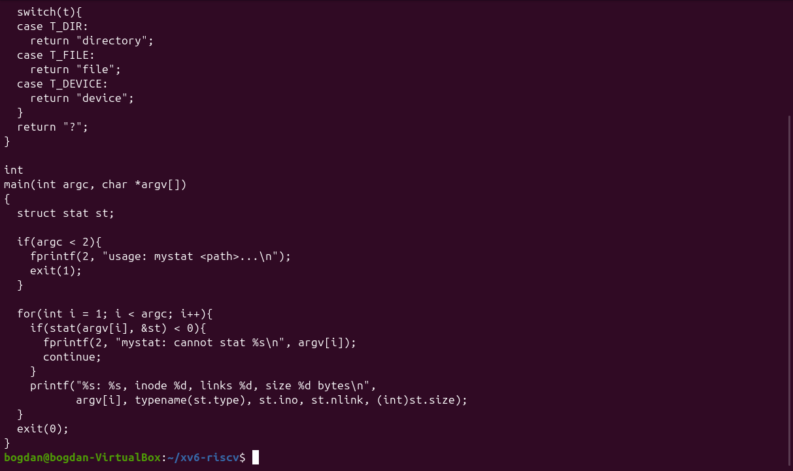
*Figure 6.2.1: The completed user/mystat.c*

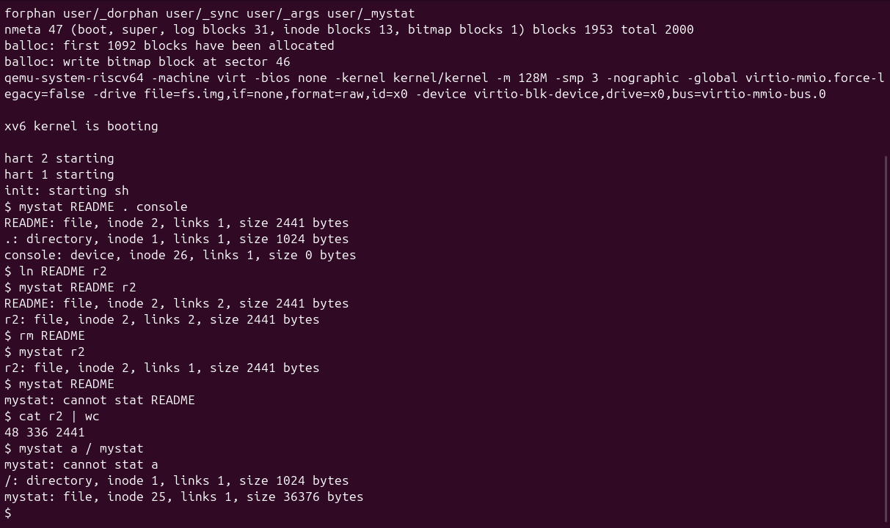
*Figure 6.2.2: mystat watching a hard link being created and removed*

**1. Paste the outputs after ln and after rm. What changed and what did not?**

After `ln README r2`: `README: file, inode 2, links 2, size 2441 bytes` and `r2: file, inode 2, links 2, size 2441 bytes`. After `rm README`: `r2: file, inode 2, links 1, size 2441 bytes`, and `mystat README` fails. Only the link count changed (1 → 2 → 1) and one name disappeared. The inode number, the type, the size and the data stayed the same: `cat r2 | wc` still gives `48 336 2441`, the same as the original README.

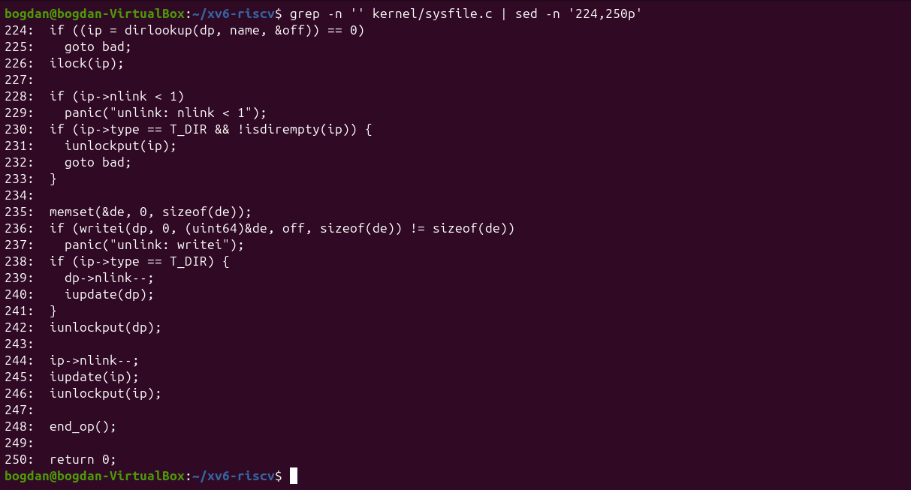
*Figure 6.2.3: sys_unlink in kernel/sysfile.c*

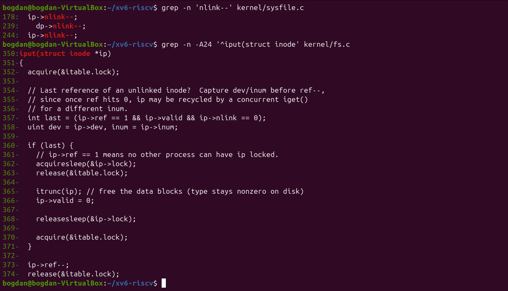
*Figure 6.2.4: The line that decrements nlink and iput(), which frees the blocks*

**2. Find the line in kernel/sysfile.c (sys_unlink) that decrements the link count. When are the data blocks freed?**

Line 244, `ip->nlink--;`, followed by `iupdate(ip)`, which writes the inode back to disk (line 239 does the same for the parent when a directory is removed). `sys_unlink` itself does not free any data: it only clears the directory entry and lowers the count. The blocks are freed later, in `iput()` in `kernel/fs.c` (lines 357–365). When the last in-memory reference goes away (`ref == 1`) and the link count is 0, `iput` calls `itrunc(ip)`, which frees all data blocks. A file that is still open therefore keeps its data until it is closed, just like on Linux.

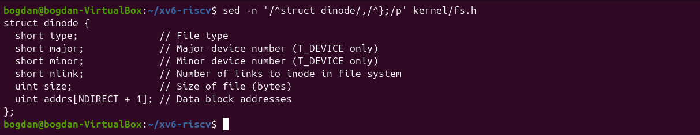
*Figure 6.2.5: struct dinode in kernel/fs.h*

**3. xv6 has no symbolic links and no permissions. Which fields does an xv6 inode have?**

`struct dinode` has only six fields: `type` (file, directory or device), `major` and `minor` (device numbers), `nlink` (number of names), `size` (in bytes) and `addrs[NDIRECT + 1]` (12 direct block numbers and 1 indirect block). There is no owner, group, mode or timestamp, unlike an ext4 inode, so xv6 cannot check permissions at all.

## Part 3. Measuring the limits

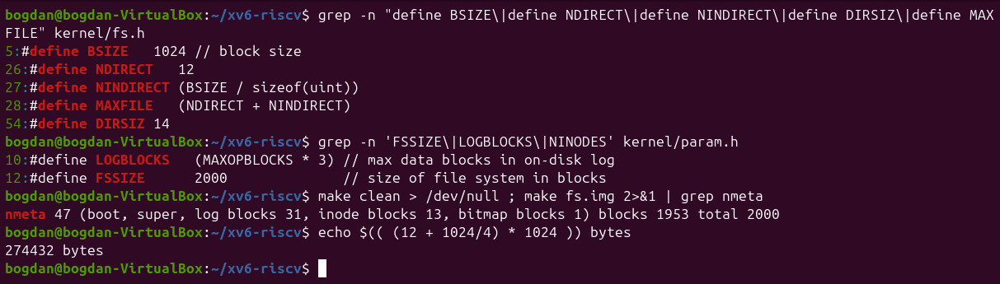
*Figure 6.3.1: BSIZE, NDIRECT, NINDIRECT, DIRSIZ and the disk layout printed by mkfs*

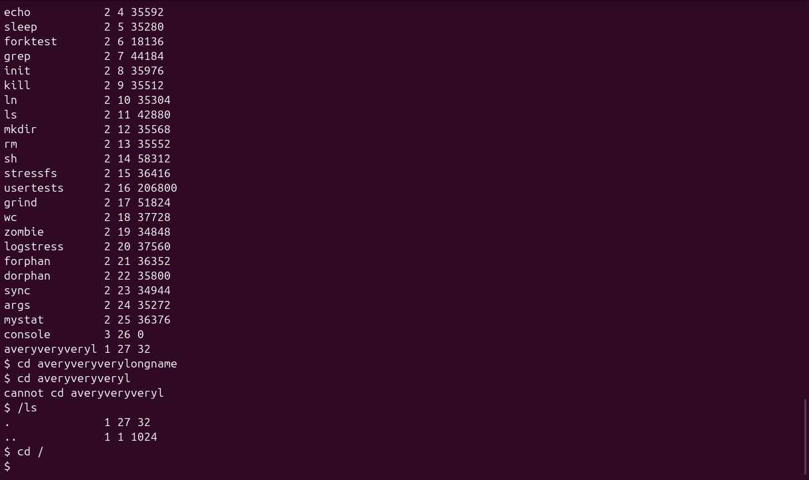
*Figure 6.3.2: A directory name longer than DIRSIZ*

**1. What does ls show for averyveryverylongname, and which constant explains it?**

`ls` shows `averyveryveryl`, only the first 14 characters, because `DIRSIZ` is 14 and the name field of a directory entry has exactly 14 bytes. Lookups also compare only 14 characters, so `cd averyveryverylongname` still worked: the extra characters are simply ignored. The next `cd averyveryveryl` failed only because I was already inside that directory.

**2. Compute the largest file xv6 can hold.**

BSIZE is 1024 bytes, and a block number takes 4 bytes. The largest file is therefore (12 + 256) × 1024 = 274 432 bytes, or 268 KB (`MAXFILE = NDIRECT + NINDIRECT = 268` blocks). The shell check `echo $(( (12 + 1024/4) * 1024 ))` printed the same number.

```text
direct blocks:     NDIRECT                = 12
indirect blocks:   NINDIRECT = 1024 / 4   = 256
max blocks:        12 + 256               = 268
max size:          268 * 1024             = 274432 bytes  (268 KB)
```

**3. From the nmeta line: how many blocks does the whole disk have, and how many are for the log, the inodes, and the data?**

`nmeta 47 (boot, super, log blocks 31, inode blocks 13, bitmap blocks 1) blocks 1953 total 2000`. The disk has 2000 blocks of 1 KB (`FSSIZE`). 47 are metadata: 1 boot block, 1 superblock, 31 log blocks, 13 inode blocks (200 inodes × 64 bytes = 16 inodes per block) and 1 free-block bitmap. The remaining 1953 blocks are for data.

## Part 4. find

My `find` starts from the structure of `ls.c`: it opens the directory, reads `struct dirent` entries one by one, builds the full path in a 512-byte buffer and calls `stat` on it. It skips free slots (`inum == 0`) and never descends into `.` or `..`. It prints a path when the last component equals the searched name, recurses into every subdirectory, and closes each directory before returning (xv6 allows only 16 open files per process). If the starting path is a file, only its name is compared. The optional `-n` argument prints the inode number next to the path.

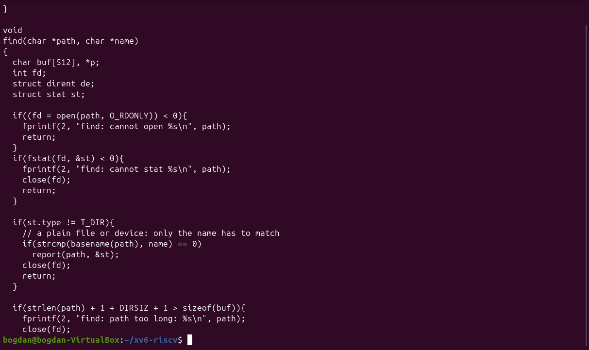
*Figure 6.4.1: user/find.c (first part)*

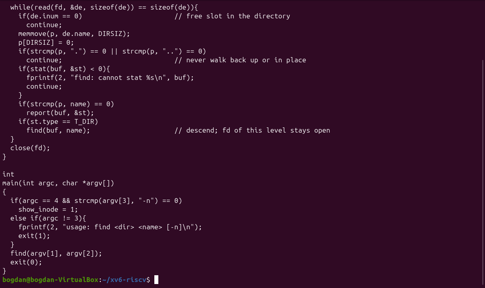
*Figure 6.4.2: user/find.c (second part)*

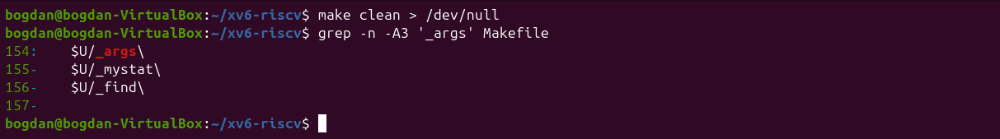
*Figure 6.4.3: The UPROGS lines for args, mystat and find*

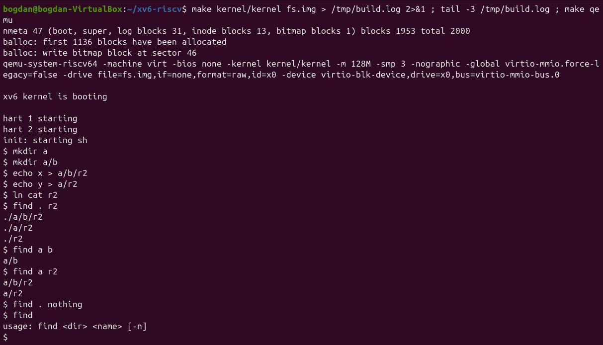
*Figure 6.4.4: find on a fresh disk*

On a fresh disk `find . r2` prints `./a/b/r2`, `./a/r2` and `./r2`, and `find a b` prints `a/b`. A name that does not exist prints nothing, and calling `find` without arguments prints the usage line.

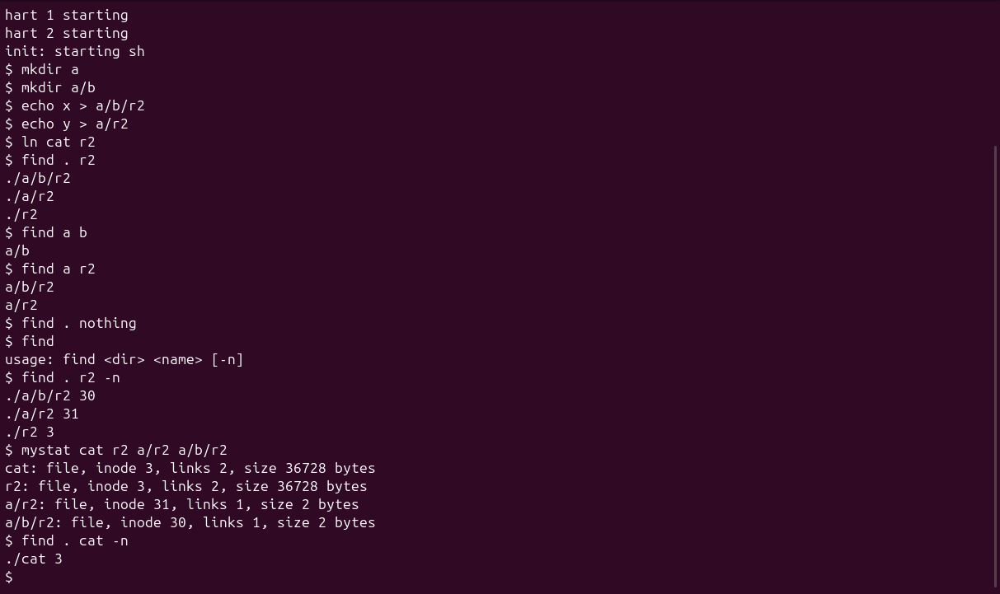
*Figure 6.4.5: Stretch: find with -n and the inodes of the three r2 files*

**Stretch.** `find . r2 -n` shows `./a/b/r2 30`, `./a/r2 31` and `./r2 3`, and `cat` also has inode 3. So only `./r2` is the same file as `cat`: it was created with `ln cat r2`, and `mystat` shows 2 links for both names. The two other `r2` files were created with `echo`, so they are independent 2-byte files with their own inodes.

#### Source of user/find.c

```text
#include "kernel/types.h"
#include "kernel/stat.h"
#include "user/user.h"
#include "kernel/fs.h"
#include "kernel/fcntl.h"

// find <dir> <name> [-n]
// Print every path under <dir> whose last component is <name>.
// With -n, the inode number is printed next to each path.

int show_inode;

// return a pointer to the last component of path ("a/b/r2" -> "r2")
char *
basename(char *path)
{
  char *p = path + strlen(path);
  while(p > path && *(p - 1) != '/')
    p--;
  return p;
}

void
report(char *path, struct stat *st)
{
  if(show_inode)
    printf("%s %d\n", path, st->ino);
  else
    printf("%s\n", path);
}

void
find(char *path, char *name)
{
  char buf[512], *p;
  int fd;
  struct dirent de;
  struct stat st;

  if((fd = open(path, O_RDONLY)) < 0){
    fprintf(2, "find: cannot open %s\n", path);
    return;
  }
  if(fstat(fd, &st) < 0){
    fprintf(2, "find: cannot stat %s\n", path);
    close(fd);
    return;
  }

  if(st.type != T_DIR){
    // a plain file or device: only the name has to match
    if(strcmp(basename(path), name) == 0)
      report(path, &st);
    close(fd);
    return;
  }

  if(strlen(path) + 1 + DIRSIZ + 1 > sizeof(buf)){
    fprintf(2, "find: path too long: %s\n", path);
    close(fd);
    return;
  }
  strcpy(buf, path);
  p = buf + strlen(buf);
  *p++ = '/';

  while(read(fd, &de, sizeof(de)) == sizeof(de)){
    if(de.inum == 0)                       // free slot in the directory
      continue;
    memmove(p, de.name, DIRSIZ);
    p[DIRSIZ] = 0;
    if(strcmp(p, ".") == 0 || strcmp(p, "..") == 0)
      continue;                            // never walk back up or in place
    if(stat(buf, &st) < 0){
      fprintf(2, "find: cannot stat %s\n", buf);
      continue;
    }
    if(strcmp(p, name) == 0)
      report(buf, &st);
    if(st.type == T_DIR)
      find(buf, name);                     // descend; fd of this level stays open
  }
  close(fd);
}

int
main(int argc, char *argv[])
{
  if(argc == 4 && strcmp(argv[3], "-n") == 0)
    show_inode = 1;
  else if(argc != 3){
    fprintf(2, "usage: find <dir> <name> [-n]\n");
    exit(1);
  }
  find(argv[1], argv[2]);
  exit(0);
}
```

## Conclusion

Lab 6 showed the same concepts in a file system small enough to read completely. An xv6 inode has only type, device numbers, link count, size and 13 block addresses. A directory is a file of 16-byte entries, which explains both the 32-byte empty directory and the 14-character name limit. The fixed numbers in `fs.h` and `param.h` give a maximum file size of 268 KB and a 2000-block disk with 47 metadata blocks. Writing `mystat` and `find` with only `open`, `read`, `fstat`/`stat` and `close` showed that a recursive tree walk needs nothing more than reading directory entries carefully and closing every directory that was opened.
