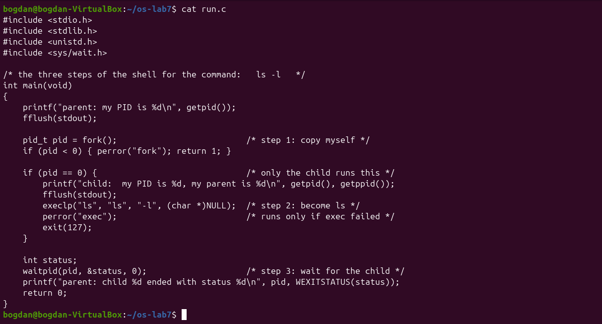
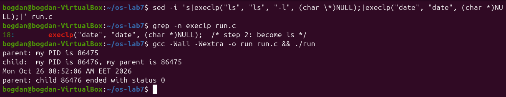
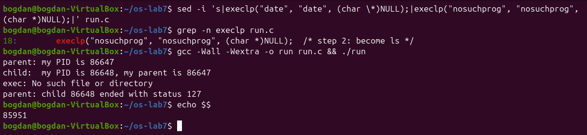
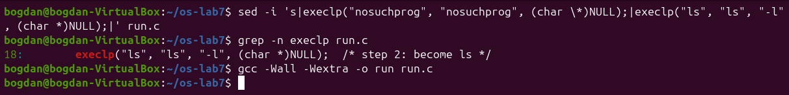
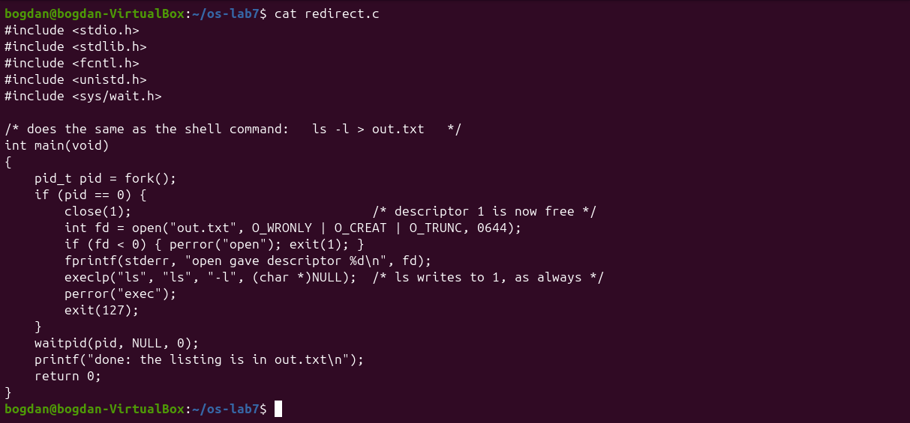
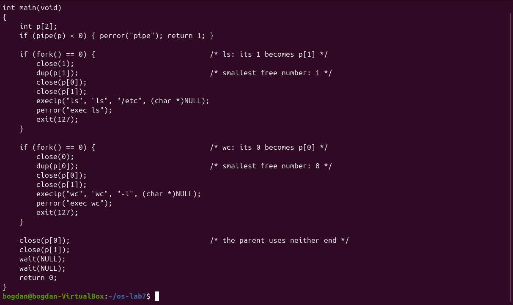
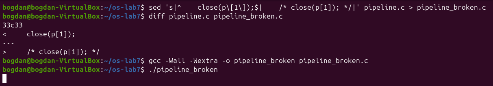
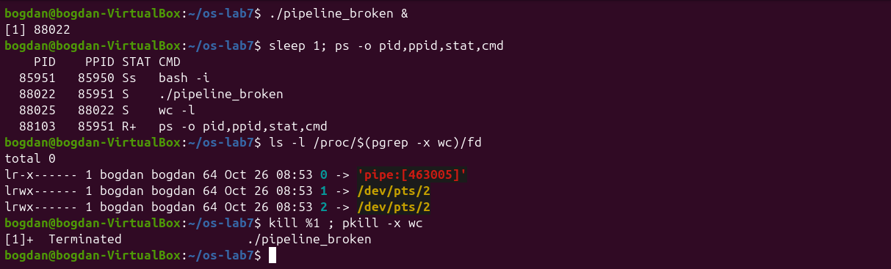
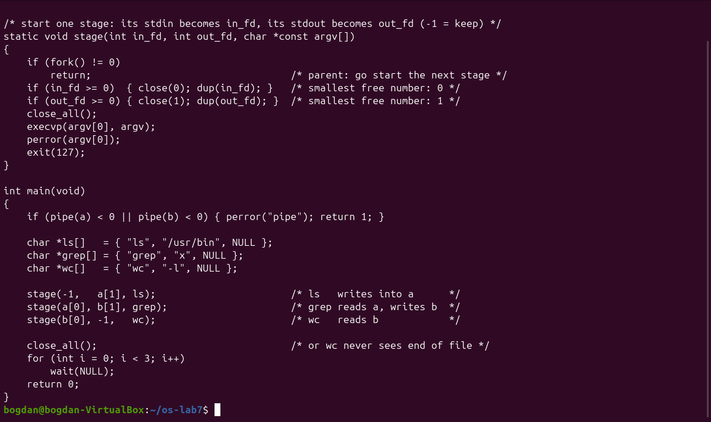

# Lab 7 – Three Small Programs: Processes, Redirection, a Pipe

*Bogdan Aramă, FAF-242 · Operating Systems, UTM 2026*

## Purpose

The purpose of Lab 7 is to run, on Linux, the three answers from the lecture: how a process is born (fork, exec, wait), where printf writes (file descriptors and redirection) and how `ls | wc -l` works (a pipe and dup). Three short C programs are compiled and run, and each is then changed in one place to see what breaks.

## Environment

| Item | Value |
|---|---|
| Machine | VirtualBox virtual machine, 2 vCPU, 3.3 GiB RAM, 25 GB disk |
| Operating system | Ubuntu 26.04.1 LTS (GNOME, Wayland) |
| Kernel | Linux 7.0.0-38-generic, x86_64 |
| Shell / terminal | GNU bash, Ptyxis terminal |
| Compiler | gcc 15.2.0 |

All programs are in `~/os-lab7` and are compiled with `gcc -Wall -Wextra` (gcc 15.2.0). None of them produced a warning.

## Getting started

*Figure 7.0.1: Compiler version and the source files*

## Part 1. fork + exec + wait

*Figure 7.1.1: run.c*

*Figure 7.1.2: run: the child becomes ls -l*

The order of the lines matches the expected output: the parent prints its PID, the child prints its own PID and its parent's, then `ls -l` writes the listing, and finally the parent reports the exit status. Then I changed the `execlp` line with `sed`, first to `date` and then to a program that does not exist.

*Figure 7.1.3: The child becomes date*

*Figure 7.1.4: exec of a program that does not exist*

*Figure 7.1.5: run.c restored to the ls version*

**1. The line perror("exec") is in the child, right after execlp. Why is it printed only with nosuchprog?**

A successful `execlp` never returns: the kernel replaces the whole memory image of the child with the new program (`ls` or `date`), so the instructions after the call no longer exist in that process. Only when exec fails (here `ENOENT`, "No such file or directory", because `nosuchprog` is in no PATH directory) does the call return -1, and the old code continues with `perror` and `exit(127)`.

**2. Which number does the child print as "my parent", and whose PID is it?**

It prints the PID of the `run` process that called `fork`. In the first run this was 86298, exactly the number the parent printed as "my PID" (and 86475 and 86647 in the next runs). The parent of `run` is in turn my shell (PID 85951, shown by `echo $$`).

**3. What status does the parent see with ls, and what status with nosuchprog?**

With `ls` (and `date`) the status is 0, because the program succeeded. With `nosuchprog` the status is 127, the value passed to `exit(127)` after the failed exec. 127 is also the code bash uses for "command not found", as seen in Lab 3. `WEXITSTATUS` extracts this number from the status word filled in by `waitpid`.

## Part 2. A zombie, on purpose

`zombie.c` is `run.c` with one extra line, `sleep(20);`, before `waitpid` (as the `diff` shows).

*Figure 7.2.1: ls appears as a zombie while the parent sleeps*

*Figure 7.2.2: After 20 seconds the zombie is gone*

**1. Which letter does ls have in the STAT column, and what does it mean?**

`Z`, shown as `[ls] <defunct>` with PPID 87024, the sleeping `./zombie` (state `S`). Z means zombie: the process has finished and released its memory, but its entry in the process table is kept so that the parent can still read its exit status. In the screenshot, bash already prints `[1]+ Done` for the job under the `ps` output, at the next prompt.

**2. After 20 seconds, is the [ls] <defunct> line still there? Which line of zombie.c made it disappear?**

No, it is gone, and so is `./zombie`. The line `waitpid(pid, &status, 0);` removed it: after `sleep(20)` the parent called `waitpid`, the kernel gave it the exit status and freed the process table entry (this is called reaping the child). Then the parent itself ended.

## Part 3. Redirection: ls -l > out.txt

*Figure 7.3.1: redirect.c*

*Figure 7.3.2: redirect: the listing goes into out.txt*

**1. Which number did open give, and why exactly that one?**

`open gave descriptor 1`. `open` always returns the lowest free descriptor number. In the child, 0 (stdin) and 2 (stderr) were still open, but 1 had just been closed, so the new file got number 1.

**2. ls was not changed at all. Why does its listing not appear on the screen?**

Open file descriptors survive `exec`. `ls` simply writes to descriptor 1 as always, but in this process descriptor 1 is now `out.txt`, not the terminal. The program never knows where its output goes, and that is exactly how the shell implements `>`. `out.txt` even lists itself with size 0, because it was created before `ls` ran.

**3. To redirect the errors instead (like 2> err.txt), which descriptor would you close before open?**

Descriptor 2: `close(2)` and then `open("err.txt", ...)` returns 2, so everything the program writes to stderr goes into the file. The `fprintf(stderr, ...)` message would then also end up in the file.

## Part 4. A pipe: ls /etc | wc -l

*Figure 7.4.1: pipeline.c*

*Figure 7.4.2: pipeline and the real shell give the same number*

Then I made a copy with the parent's `close(p[1]);` commented out (`pipeline_broken.c`, the `diff` shows the single changed line). Running it hangs, with no output, until Ctrl-C. Running it in the background lets `ps` show which process is waiting.

*Figure 7.4.3: Without close(p[1]) in the parent the program never ends*

*Figure 7.4.4: ps shows that wc is the child that never ends*

**1. Did ./pipeline and ls /etc | wc -l give the same number?**

Yes, both printed 236.

**2. After the change, which of the two children never ends, ls or wc?**

`wc`. `ps` shows `wc -l` in state S (sleeping) as a child of `./pipeline_broken`, while `ls` is already gone: it wrote its listing and exited. The descriptor list of `wc` shows that its stdin (0) is `pipe:[463005]`. The parent hangs in its second `wait`.

**3. Why, in one sentence: what is wc waiting for?**

`wc` is waiting for end-of-file on the pipe, which comes only when every write end is closed, and the parent still holds an open copy of `p[1]`, so `read` keeps blocking.

## Optional: three stages

`pipeline3.c` builds `ls /usr/bin | grep x | wc -l` with two pipes and three children. A small helper `stage(in, out, argv)` forks a child, moves the given ends onto descriptors 0 and 1 with `close` + `dup`, closes all four pipe ends and calls `execvp`. The parent also closes all four ends before waiting for the three children.

*Figure 7.5.1: pipeline3.c*

*Figure 7.5.2: pipeline3 and the shell both print 221*

## Conclusion

Lab 7 showed that the three tricks of the shell are built from a handful of system calls. `fork` + `exec` + `wait` start a program and collect its exit status, and forgetting the `wait` leaves a zombie. Redirection works because `open` returns the lowest free descriptor and descriptors survive `exec`. A pipe is just two descriptors placed on 0 and 1 with `dup`. The broken version showed the most important rule of pipes: every unused write end must be closed, otherwise the reader never sees end-of-file.
