# Lab 8 – The Same Calls Inside Your Own OS (xv6)

*Bogdan Aramă, FAF-242 · Operating Systems, UTM 2026*

## Purpose

The purpose of Lab 8 is to run the same fork/exec/wait program inside xv6, the operating system built during the semester, to see that the system calls are the same, and then to make two processes talk through pipes with `pingpong` (and, optionally, a chain of processes with `primes`).

## Environment

| Item | Value |
|---|---|
| Host system | Ubuntu 26.04.1 LTS in VirtualBox (2 vCPU, 3.3 GiB RAM) |
| Cross compiler | riscv64-linux-gnu-gcc 15.2 |
| Emulator | QEMU 10.2 (qemu-system-riscv64, machine virt, 3 harts) |
| xv6 source | mit-pdos/xv6-riscv, revision 06aad25, branch lab, in ~/xv6-riscv |
| Prepared with | os2026-setup.sh (check mode reports "All set") |

The programs `run`, `pingpong` and `primes` were added to `~/xv6-riscv/user/` and to UPROGS. `zombie` was already in the list. QEMU is left with Ctrl-A X before each rebuild.

## Part 1. run, inside xv6

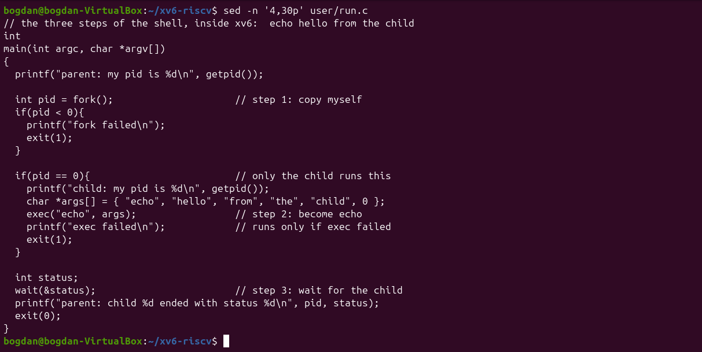
*Figure 8.1.1: user/run.c*

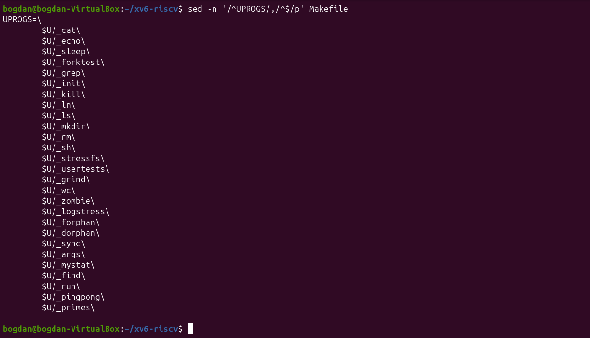
*Figure 8.1.2: The UPROGS list with run, pingpong and primes*

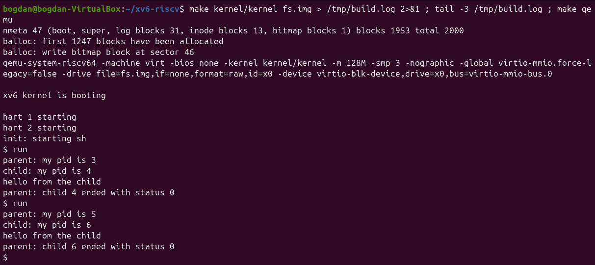
*Figure 8.1.3: run inside xv6: the child becomes echo*

The output matches the assignment: `parent: my pid is 3`, `child: my pid is 4`, `hello from the child`, `parent: child 4 ended with status 0`. A second run gets PIDs 5 and 6, because xv6 never reuses a PID number.

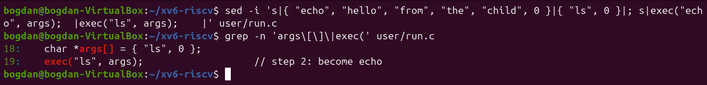
*Figure 8.1.4: Changing the child to run ls*

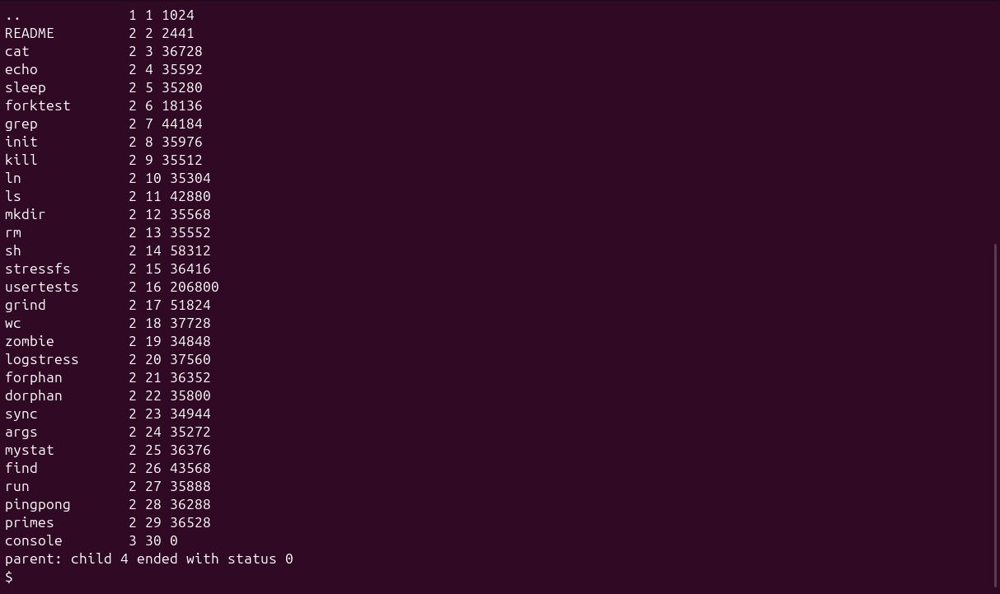
*Figure 8.1.5: run with the child running ls*

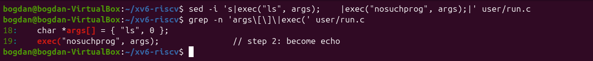
*Figure 8.1.6: Changing the child to exec a missing program*

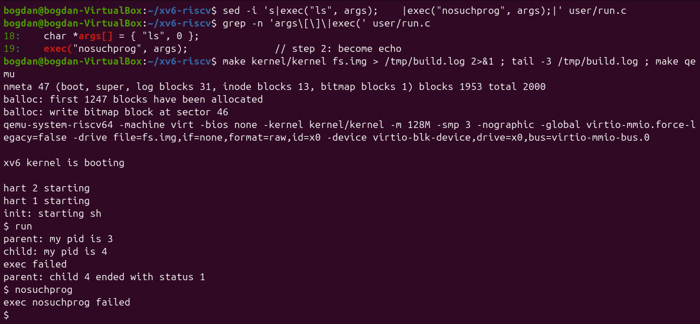
*Figure 8.1.7: exec failed and status 1*

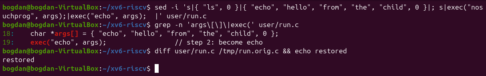
*Figure 8.1.8: user/run.c restored to the echo version*

**1. Write the three calls that run.c uses in xv6 and the three calls run.c used on Linux in Lab 7. What is the same?**

xv6: `fork()`, `exec("echo", args)` and `wait(&status)`. Linux: `fork()`, `execlp("ls", "ls", "-l", NULL)` and `waitpid(pid, &status, 0)`. The model is identical: copy the process, replace the copy's program, then wait in the parent. Even the structure of the code is the same. The differences are only in the interface: xv6 `exec` takes a path and an argv array and does no PATH search (it works here because `echo` is in `/`), `wait` waits for any child, and the status is the plain exit value with no `WEXITSTATUS` decoding.

**2. Who prints "hello from the child": the code of run, or echo?**

`echo` does. After a successful `exec` the child process is no longer running the code of `run`: its memory now holds `echo`, which prints its arguments `hello from the child`. The only lines `run` itself prints in the child are "child: my pid is ..." (before exec) and, if exec fails, "exec failed".

**3. Why is the status 1 here and 127 on Linux?**

Because each program chooses the value it passes to `exit` after a failed exec: the xv6 version calls `exit(1)` and the Linux version calls `exit(127)`. The kernel only delivers that number to the parent's `wait`. 127 on Linux is just the shell convention for "command not found". The xv6 shell itself prints `exec nosuchprog failed` in that case.

## Part 2. pingpong

The four TODO lines become `read(p2c[0], &b, 1)` and `write(c2p[1], &b, 1)` in the child, and `write(p2c[1], &b, 1)` and `read(c2p[0], &b, 1)` in the parent. I also check that each call really transferred one byte.

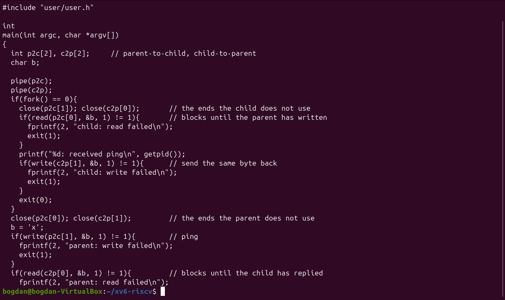
*Figure 8.2.1: user/pingpong.c (first part)*

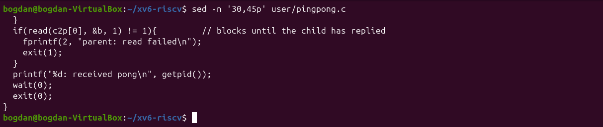
*Figure 8.2.2: user/pingpong.c (end)*

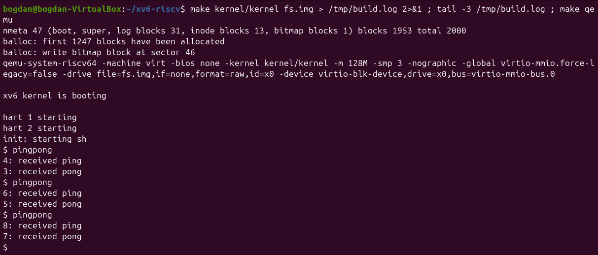
*Figure 8.2.3: pingpong: ping always comes first, from the child*

In all three runs "received ping" is printed first by the child (`4: received ping`) and then "received pong" by the parent (`3: received pong`).

**1. Why do you need TWO pipes, and not one for both directions?**

A pipe is one-way: it has one read end and one write end, and its bytes are not addressed to anyone. With a single pipe, the parent's `read` could take back the byte the parent itself had just written, before the child read it, and nothing would make the reply go to the right process. Two pipes give each direction its own channel: `p2c` only goes parent to child and `c2p` only goes child to parent.

**2. Nothing in your code says "wait until the child has replied". Which call makes the parent wait?**

`read(c2p[0], &b, 1)`. Reading from an empty pipe blocks: the kernel puts the parent to sleep until the child writes its byte into `c2p` (or until every write end is closed). In the same way the child's `read(p2c[0], ...)` blocks until the ping arrives, which is why "ping" is always printed before "pong".

## Optional: primes

`primes` feeds the numbers 2–35 into a pipe. Each stage reads its first number p (always a prime) and prints it, then creates a new pipe and a child and forwards only the numbers that p does not divide. Every stage closes the pipe ends it does not use, so the chain ends cleanly with end-of-file.

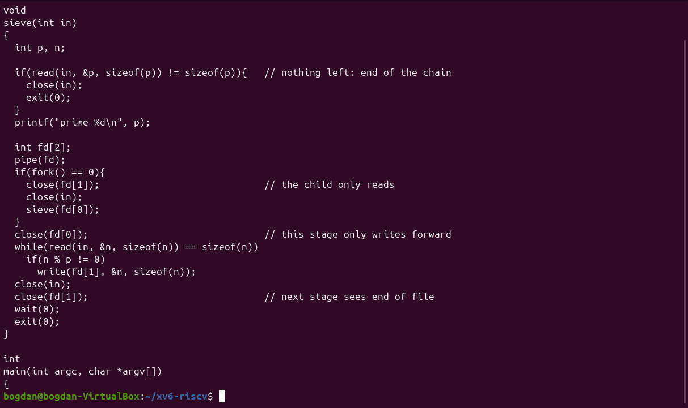
*Figure 8.3.1: user/primes.c*

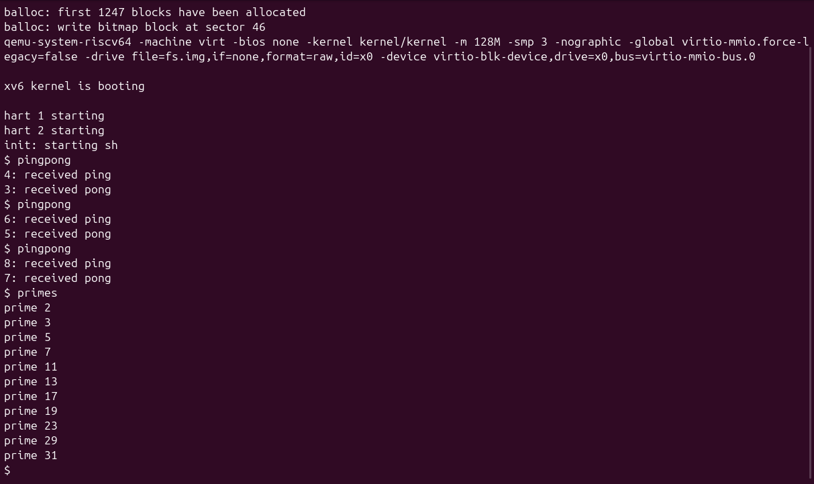
*Figure 8.3.2: primes prints the primes from 2 to 31*

## Conclusion

Lab 8 showed that xv6 offers the same process model as Linux: the same `fork`/`exec`/`wait` program runs almost unchanged, and only the library conveniences (PATH search, `waitpid`, status macros) are missing. With `pingpong`, two processes synchronised only through blocking `read` calls on two one-way pipes. `primes` extended the same idea to a whole chain of processes, where closing the unused ends is what lets the chain finish.
